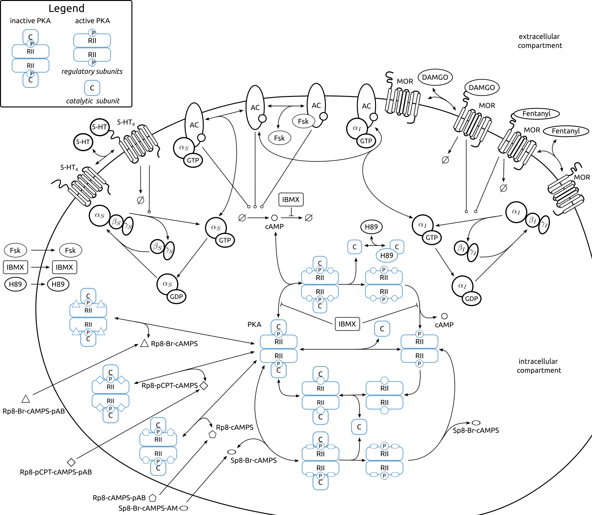

# A mechanistic model of protein kinase A dynamics under pro- and anti-nociceptive inputs

This repository contains all python files and (supplementary) figures for the manuscript 
"A mechanistic model of protein kinase A dynamics under pro- and anti-nociceptive inputs".



## Requirements
This project relies on the following key software packages:

  - [PEtab](https://github.com/PEtab-dev/libpetab-python) (v0.7.0):
    reads and validates the parameter estimation problem,
    which is specified in the PEtab 1.0 format (see below).
    [Documentation](https://petab.readthedocs.io/)
  - [AMICI](https://github.com/AMICI-dev/AMICI) (v0.34.2):
    simulates the model and computes gradients.
    AMICI translates the SBML model into C++ code and compiles it into a Python module,
    which is why a C++ compiler and further system dependencies are required (see step 3 below).
    [Documentation](https://amici.readthedocs.io/en/v0.34.2/)
  - [pyPESTO](https://github.com/ICB-DCM/pyPESTO) (v0.5.7):
    performs parameter estimation, profile calculation, and ensemble analysis,
    and stores the results in HDF5 files.
    [Documentation](https://pypesto.readthedocs.io/)
  - [Fides](https://github.com/fides-dev/fides) (v0.8.0):
    the local optimizer used by pyPESTO.

The analysis was performed using Python 3.11.1. Additional dependencies are listed in `requirements.txt`, 
which can be installed with 
```bash 
pip install -r requirements.txt
```
The listed versions correspond to those used in this study.

## Models and parameter estimation problems
We developed a mechanistic model of PKA activity in nociceptive neurons that explicitly links 
receptor activation to downstream kinase regulation. The model is implemented in the Systems Biology Markup Language ([SBML](https://sbml.org/)), 
and the parameter estimation problem was described in the [PEtab 1.0 format](https://github.com/PEtab-dev/PEtab). 
PEtab is a standardized format for specifying parameter estimation problems in systems biology. 
It combines a dynamic model (typically in SBML format) 
with tab-separated values (TSV) files for descriptions of experimental data, 
simulation conditions, observables, and parameters, enabling reproducible model calibration and 
benchmarking across different software tools.

The PEtab tables are plain `.tsv` files and can be inspected in any spreadsheet application. 
Alternatively, the PEtab problems can be inspected with [PEtab-GUI](https://github.com/PEtab-dev/PEtab-GUI), 
which is not required for the analysis.
PEtab-GUI should be installed in an isolated environment, 
since its dependencies are incompatible with those of the analysis environment.
For example, using [pipx](https://pipx.pypa.io/):
```bash
pipx install petab-gui --pip-args='petab<0.10.0'
petab_gui model/petab/PKAcycleMOR.yaml
```

PEtab files for the core model of PKA activity in nociceptive neurons are located in
- `model/petab`  
  The model captures ligand-dependent receptor
  activation, subsequent G-protein signaling, and its regulatory effects on AC activity and
  cAMP synthesis, ultimately linking these processes to PKA activation through cAMP
  binding. The SBML model definition is provided in the file `PKAcycleMOR_model.xml`. 
  This file is identical across all nested folders and is duplicated for convenience when performing 
  model validation and running _in silico_ experiments. 
  The model parameters that are required for model simulation are specified in `parameters_PKAcycleMOR.tsv`.
  - `in_silico_exp`  
    This folder contains PEtab files for _in silico_ experiments shown in Figure 7. 
    The `measurementData_PKAcycleMOR.tsv` file in this folder contains placeholder values for the measurements, 
    which are not used for parameter estimation.
  - `validation`  
    This folder contains PEtab files for simulating the conditions contained in the validation set.
    This was used to generate Figure 6. Files `measurementData_PKAcycleMOR_only_validation.tsv` and 
    `exp2/measurementData_exp2.tsv` contain measurements that were only used for model validation.
    Files `measurementData_PKAcycleMOR_only_validation__smooth.tsv` and `exp2/measurementData_exp2_smooth.tsv` 
    in this folder contain placeholder values for the measurements, that were used for model simulation.
  - `experimentalCondition_PKAcycleMOR.tsv`  
    [Condition table](https://petab.readthedocs.io/en/latest/v1/documentation_data_format.html#condition-table). 
    Conditions ending in `_\d+` (e.g. `model1_data1_1`-`model1_data1_9`) are added to the table for simulation and visualization purposes.
    All other conditions describe conditions of actually performed experiments.
  - `measurementData_PKAcycleMOR.tsv`  
    [Measurement table](https://petab.readthedocs.io/en/latest/v1/documentation_data_format.html#measurement-table) that contains experimental measurements that were used for parameter estimation (the training dataset). 
    Comparisons between model simulations and experimental data contained in this file are shown in Figure 3.
  - `measurements_smooth.tsv`  
    Measurement table for model simulation and visualization, including additional time points and conditions to enable finer resolution and smoother trajectories.
    Measurement values at the additional time points are placeholders and are not used for parameter estimation.
    Actual experimental measurements are contained in `measurementData_PKAcycleMOR.tsv`.
  - `observables_PKAcycleMOR.tsv`  
    [Observables table](https://petab.readthedocs.io/en/latest/v1/documentation_data_format.html#observables-table).
  - `parameters_PKAcycleMOR.tsv`  
    [Parameter table](https://petab.readthedocs.io/en/latest/v1/documentation_data_format.html#parameter-table). 
    The best parameter values found during model calibration are reported in the `nominalValue` column.
  - `PKAcycleMOR.yaml`  
    [YAML file for grouping files](https://petab.readthedocs.io/en/latest/v1/documentation_data_format.html#yaml-file-for-grouping-files).
  - `PKAcycleMOR_model.xml`  
    [SBML model definition](https://petab.readthedocs.io/en/latest/v1/documentation_data_format.html#sbml-model-definition).
  - `visualizationSpecification_PKAcycleMOR.tsv`  
    [Visualization table](https://petab.readthedocs.io/en/latest/v1/documentation_data_format.html#visualization-table).

PEtab files for the extended model are located in
- `model/petab_feedback`  
  An additional reaction for G<sub>I</sub> protein activation, 
  with a rate proportional to the concentration of the pRII<sub>2</sub>:cAMP<sub>4</sub> complex was added to the core model.
  This folder contains PEtab files for _in silico_ hypothesis testing shown in Figure 8.
  - `experimentalCondition_PKAcycleMOR.tsv`  
    [Condition table](https://petab.readthedocs.io/en/latest/v1/documentation_data_format.html#condition-table). 
    Conditions ending in `_\d+` (e.g. `model1_data1_1`-`model1_data1_9`) are added to the table for simulation and visualization purposes.
    All other conditions describe conditions of actually performed experiments.
  - `measurementData_PKAcycleMOR.tsv`  
    [Measurement table](https://petab.readthedocs.io/en/latest/v1/documentation_data_format.html#measurement-table) that contains experimental measurements that were used for parameter estimation (the training dataset).
  - `measurements_smooth.tsv`  
    Measurement table for model simulation and visualization, including additional time points and conditions to enable finer resolution and smoother trajectories.
    Measurement values at the additional time points are placeholders and are not used for parameter estimation.
    Actual experimental measurements are contained in `measurementData_PKAcycleMOR.tsv`.
  - `observables_PKAcycleMOR.tsv`  
    [Observables table](https://petab.readthedocs.io/en/latest/v1/documentation_data_format.html#observables-table).
  - `parameters_PKAcycleMOR.tsv`  
    [Parameter table](https://petab.readthedocs.io/en/latest/v1/documentation_data_format.html#parameter-table). 
    The best parameter values found during model calibration are reported in the `nominalValue` column.
  - `PKAcycleMOR.yaml`  
    [YAML file for grouping files](https://petab.readthedocs.io/en/latest/v1/documentation_data_format.html#yaml-file-for-grouping-files).
  - `PKAcycleMOR_model.xml`  
    [SBML model definition](https://petab.readthedocs.io/en/latest/v1/documentation_data_format.html#sbml-model-definition).
  - `visualizationSpecification_PKAcycleMOR.tsv`  
    [Visualization table](https://petab.readthedocs.io/en/latest/v1/documentation_data_format.html#visualization-table).

- `model/copasi`  
  This folder contains the COPASI model definition of the core model for most datasets used for parameter estimation.
  In each file, the parameter values were configured to match the corresponding experimental conditions, 
  and all estimated parameters were set to the values of the best-fitting parameter vector. 
  The dataset numbering corresponds to the numbering used in Figure 3.

## Scripts

This repository includes several analysis scripts in `src/` used to run optimization, ensemble predictions and generate the paper figures. Short descriptions:

- `src/optimization.py`  
  Implements the startpoint sampling, parameter estimation, saving results to HDF5, simulation with best parameter vectors, and profile posterior calculations. Key entry points: `sample_startpoints()`, `optimize()`, `simulate_w_best_parameter()` / `simulate_and_visualize()`, and `create_profiles()`.
  Figure 2a and b were generated using `simulate_and_visualize()`. 
  Figure 4 was generated using `visualize_profile_confidence_intervals`.

- `src/in_silico_experiments.py`  
  Driver script for running in‑silico experiments (uses the PEtab problem in `petab/in_silico_exp`). It builds ensembles from optimization results and produces ensemble visualizations and state trajectory plots via `create_prediction()` and the plotting helpers in `src/ensemble.py`.
  Figure 7 was generated using this script.

- `src/feedback_hypothesis.py`  
  Utilities for exploring the proposed feedback mechanism: simulate state trajectories from chosen parameter vectors, write flux tables (per-condition), and plot G-protein activation flux contributions. Useful functions include `simulate_states_petab()`, `write_fluxes()`, and `visualize_Gactivity_flux()`.
  Figure 8 was generated using this script.

- `src/ensemble.py`  
  Core ensemble utilities: construct ensembles (from optimization endpoints or histories), predict observables and full state trajectories for all ensemble members, and state visualizations.
  Figures 2 and 5 were generated using this script, as well as the Supplementary Figure S4.

- `src/visualization.py`  
  Helper functions for plotting and visualizing simulation results, including observables and state trajectories. Used by `optimization.py`, `in_silico_experiments.py`, and `feedback_hypothesis.py`.

- `src/validation.py`  
  Driver script for simulating the validation dataset (uses the PEtab problem in `petab/validation`). 
  It produces visualizations of the validation data and model predictions.
  Figure 6 was generated using this script.

## Reproducing the analysis

There are two ways to reproduce the study results:

1. Full analysis reproduction: run the optimization workflow from scratch. This is the most complete option, but it is computationally demanding because it re-estimates the model parameters and performs the associated uncertainty analysis.
2. Figure reproduction from provided result files: if you do not want to rerun the optimization, you can use the shipped result files in `model/results/` (`result.h5`, `best_parameter_vector.tsv`, and `profile_results.h5`) to regenerate the figures.

The main entry point for the full workflow is `src/optimization.py`, which compiles the AMICI model, samples optimization starting points, runs the parameter estimation, and saves the results in `model/results/`.

1. Clone the repository and move into the project directory:
   ```bash
   git clone https://github.com/plakrisenko/Pain_signaling_code.git
   cd Pain_signaling_code
   ```
   If you prefer to work from an archived release, the corresponding Zenodo download can be used instead of `git clone`.

2. Create and activate a Python virtual environment:
   ```bash
   python3.11 -m venv .venv
   source .venv/bin/activate
   ```

3. Install the AMICI system requirements. The AMICI installation guide is the authoritative reference for platform-specific prerequisites:
   https://amici.readthedocs.io/en/v0.34.2/python_installation.html.
   In particular, make sure that the required C/C++ toolchain and SWIG dependencies are installed before installing the Python package.

4. Install the project requirements:
   ```bash
   python -m pip install --upgrade pip                                      
   echo "swig==4.4.0" > build-constraints.txt
   pip cache remove amici 
   pip install --build-constraint build-constraints.txt -r requirements.txt
   ```

5. Adjust the simulation and optimization settings in `model/config.yaml` if needed. 
   The most relevant setting is the number of local optimization runs:
   ```yaml
   optimize:
     n_optimizations: 2
   ```
   This controls how many local optimization runs are started. 
   The model calibration is computationally demanding, and increasing this value substantially 
   (for example to 1000) can require significant CPU time and memory and will not be feasible on a standard laptop.
   Similarly, posterior profile calculations can be computationally demanding. 
   To select parameters for which to compute posterior profiles, provide a list of parameter 
   indices to `create_profiles` function in `src/optimization.py`.

6. Run the optimization workflow from the `src/` directory. The script supports a `--mode` flag with the following options:
    - `full` (default option) runs the full analysis workflow (optimization, result export, and figure generation).
    - `visualize-only` skips the expensive optimization step and regenerates figures from existing result files.    
    Examples:
    ```bash
    python optimization.py --mode full
    python optimization.py --mode visualize-only
    ```
    To reproduce the figures from the provided result files, use the `visualize-only` option:
   ```bash
   cd src
   python optimization.py --mode visualize-only
   ```

7. Inspect the generated outputs. The key files are:
   - `model/results/result.h5` - optimization results
   - `model/results/best_parameter_vector.tsv` - best-fit parameter vector
   - `model/results/figures/` - generated plots for model fits and diagnostics. These figures are used in the Fig. 2 of the manuscript.
   - `model/results/simulation_0/` - generated plots for model simulations with the best-fit parameter vector
   - `model/results/figures/parameter_uncertainty/profile_cis*` and `model/results/figures/parameter_uncertainty/identifiability_fraction*`- These figures are used in the Fig. 4 of the manuscript.

8. Run the ensemble workflow from the `src/` directory to generate ensemble predictions and visualizations:
   ```bash
   python ensemble.py
   ```
   Requires the optimization results from step 6.
   Setting `ens_from_profiles = False` in `src/ensemble.py` (line 1171) creates figures for Fig.3, setting `ens_from_profiles = True` creates figures for Fig.5.
   The resulting figures are:
   - `model/results/figures/ensemble_simulation` - These figures are used in the Fig. 3 and Fig. 5 of the manuscript.
   - `model/results/figures/ensemble_simulation/states` - These figures are used in the Supporting Information Fig S4.
   - `model/results/figures/parameter_uncertainty/ens_parameter_plot*` -  These figures are used in the Supporting Information Fig S3.

9. Run the validation workflow from the `src/` directory to generate validation visualizations:
   ```bash
   python validation.py
   ```
   Requires the optimization results from step 6.
   The resulting figures are:
   - `model/results/figures/validation` - These figures are used in the Fig. 6 of the manuscript.

10. Run the in-silico experiments from the `src/` directory to generate in-silico experiment visualizations:
   ```bash
   python in_silico_experiments.py
   ```
   Requires the optimization results from step 6.
   The resulting figures are:
   - `model/results/figures/ensemble_simulation/in_silico` - These figures are used in the Fig. 7 of the manuscript.
     The two figures in Fig. 7 (b) are 
     `model/results/figures/ensemble_simulation/in_silico/states/insilico_DAMGO_5HT__state_total_MOR_<n_ens>.svg`
     and `model/results/figures/ensemble_simulation/in_silico/states/insilico_Fentanyl_5HT__state_total_MOR_<n_ens>.svg`,
     where `<n_ens>` is the number of ensemble members used for the simulation.
     The figure in Fig. 7 (c) is `model/results/figures/ensemble_simulation/in_silico/states/insilico_DAMGO_5HT__state_total_5HT4_<n_ens>.svg` or 
     `model/results/figures/ensemble_simulation/in_silico/states/insilico_Fentanyl_5HT__state_total_5HT4_<n_ens>.svg`, as these two figures are identical.

11. Run optimization and result visualization for the extended model from the `src/` directory:
    ```bash
    python feedback_hypothesis.py
    ```
    To reproduce the figures from the provided result files, use the `visualize-only` option:
    ```bash
    python feedback_hypothesis.py --mode visualize-only
    ```
